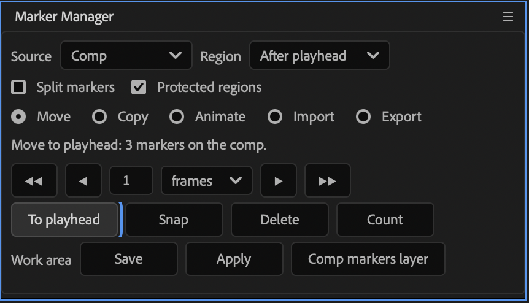

# Marker Manager


### Move, copy and paste After Effects markers in bulk
[](https://github.com/garethnunns/ae-marker-manager/actions/workflows/check.yml) [](https://github.com/garethnunns/ae-marker-manager/releases/latest) [](https://github.com/garethnunns/ae-marker-manager/releases) [](#install) [](LICENSE)

<br clear="left">

An After Effects panel for working with lots of markers at once: move, copy, cut, paste and delete comp and layer markers in bulk, keep sets of them in memory banks, trigger animation from them, and import them from a CSV file or straight from Reaper.



Free and open source, under the [MIT licence](LICENSE).

## Install

1. Download `Marker Manager.jsx` from the [latest release](https://github.com/garethnunns/ae-marker-manager/releases/latest).
2. Put it in After Effects' `Scripts/ScriptUI Panels` folder:
   - macOS: `/Applications/Adobe After Effects <version>/Scripts/ScriptUI Panels/`
   - Windows: `C:\Program Files\Adobe\Adobe After Effects <version>\Support Files\Scripts\ScriptUI Panels\`
3. Restart After Effects and open it from **Window > Marker Manager.jsx**. Dock it wherever suits.

For importing from Reaper or exporting a CSV file, turn on **Settings > Scripting & Expressions > Allow Scripts to Write Files and Access Network**.

It can also be run once, without installing, from **File > Scripts > Run Script File…**, as a floating window.

## Which markers

Everything in the panel works on the markers chosen at the top:

| Setting | What it does |
| --- | --- |
| Source | **Auto** (the default): the selected layers' markers, or the comp's when no layer is selected. Or always the **Comp**, or always **Selected layers**. |
| Region | Markers starting in the **Work area**, the **Whole comp**, **Before playhead** or **After playhead**. |
| Split markers | Markers with a duration move each end separately: only the ends in range move, so the work area can stretch or shorten them. |
| Protected regions | Include protected region markers. Off leaves them where they are. |

## Move

- **◀** and **▶** move the markers earlier or later by the amount between them, in frames or seconds. Hold **Shift** to move ten times as far, or **Alt** (Option) to move the other way. **◀◀** and **▶▶** move ten times as far too.
- **To playhead** moves them together so the first starts at the playhead.
- **Snap** moves any between frames onto the nearest one.
- **Delete** deletes them, and **Count** says how many there are.
- **Work area: Save / Apply** remembers a comp's work area, to put it back or set the same one on another comp.
- **Comp markers layer** makes a guide layer with a copy of the comp markers, so J and K (which only jump between layer markers) jump between them too. Press it again after changing the comp markers to bring it up to date.

Nothing is moved before the start of the comp: a move that would is refused whole.

## Copy

- **Copy** and **Cut** take the markers from every selected layer (or the comp). Markers at the same time on more than one layer are taken once.
- **Paste** puts them on every selected layer (or the comp), at their own times or, with **At playhead**, from the playhead. **Clear range first** deletes the markers in range before pasting.
- **Memory banks**: **Store** keeps what was copied in one of five banks, kept between sessions and projects; **Paste** pastes it back, as Paste does.

Pasting onto a marker at the same time replaces it.

## Animate

Select keyframed properties in the timeline and press **Add trigger**: each property's animation (first keyframe to last) then plays from every marker instead of when it was keyframed, holding its first keyframe before the first marker and its last after. One set of keyframes can then be repeated across a whole comp.

| Setting | What it does |
| --- | --- |
| From | The property's own layer's markers, the comp's, or **Another layer**'s (named in the box beside it). |
| Named | Only markers whose name contains this, so different animations can follow different markers. |
| Delay | Frames after each marker to start. |
| Length | Frames the animation takes; 0 keeps it as keyframed. |
| Fit to marker duration | Markers with a duration stretch the animation to fit them. |
| Reverse | Plays the keyframes backwards. |

The settings are at the top of the expression, to change by hand later. **Remove trigger** takes it off again (and leaves other expressions alone).

## Import

### From a CSV file

Reads Reaper's region/marker export (**View > Region/Marker Manager**, then right-click > **Export**) and simpler files: a header row naming the columns (Start, Time or In; Name or Comment; End; Length or Duration; Chapter; URL, and so on) or, without one, the time then the name.

| Setting | What it does |
| --- | --- |
| Times | How the times are written: **auto** (worked out from them), or timecode, minutes:seconds, seconds, frames or samples. |
| fps | The file's frame rate, for timecode and frames. Empty uses the comp's. |
| Hz | The sample rate, for times in samples. |

Reaper writes times as its ruler shows them: set it to timecode or minutes:seconds before exporting, as measures and beats can't be read without the tempo.

### Straight from Reaper

Turn on Reaper's web interface once (**Preferences > Control/OSC/Web > Add > Web browser interface**, and note its port), then **Pull from Reaper** reads its markers and regions (as markers with a duration) and imports them. Nothing needs installing in Reaper.

| Setting | What it does |
| --- | --- |
| Address and port | Where Reaper is running (`127.0.0.1` for this computer) and its web interface's port. |
| Markers, Regions | Which to import. |
| fps | Reaper's project frame rate, to read its project start time. Empty uses the comp's. |

### Into the comp

| Setting | What it does |
| --- | --- |
| Place | **At their timecode** (a marker at 01:00:10:00 lands at 01:00:10:00 in the comp, allowing for the comp's start timecode and Reaper's project start time), **From the comp's start**, **From the playhead**, or **First one at the playhead**. |
| Existing | **Replace imported** (the default): replaces what was imported before, so importing again updates them. Or **Keep all**, or **Replace all** markers. |
| Snap | Puts each marker on the nearest frame. |

Imported markers remember where they came from (a `sourceId` cue point parameter, such as Reaper's `M3` or `R2`), which is how importing again knows which to replace.

## Export

**Export CSV…** saves the markers in range as a CSV file laid out as Reaper's export, in timecode, minutes:seconds or seconds.

## Development

The panel is one ExtendScript file built from `src/`:

- `src/core/` is plain ES3 with no After Effects in it: times and timecode, CSV, marker operations, Reaper's protocol, the trigger expression. It runs the same under Node, where the unit tests run it.
- `src/ae/` is what talks to After Effects: reading and writing markers, files and the network, and the panel.

```sh
npm install
npm run verify     # build dist/Marker Manager.jsx, check it's ES3, run the unit tests
npm run test:ae    # run tests/ae/smoke.jsx in the After Effects that's open (macOS)
npm run install:ae # copy the build into the newest After Effects' ScriptUI Panels
```

`npm run test:ae` adds a comp to the open project, tests every action on it, and deletes it again. It needs After Effects open, and leaves the project marked as changed.

### Releasing

Bump the version in `package.json`, add `docs/release-notes/<version>.md`, commit, and push a `v<version>` tag: the release workflow builds the panel and publishes it.

## Roadmap

- Pull from Reaper live, as markers change, rather than on request.
- Map Reaper's marker colours to label colours.
